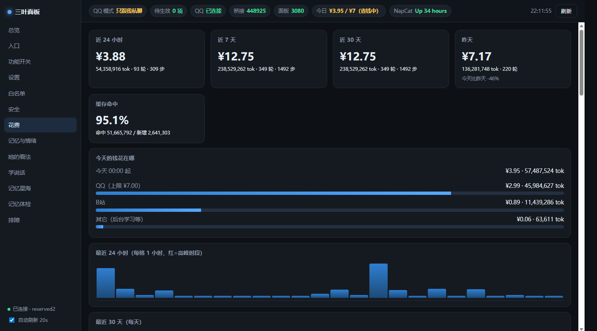
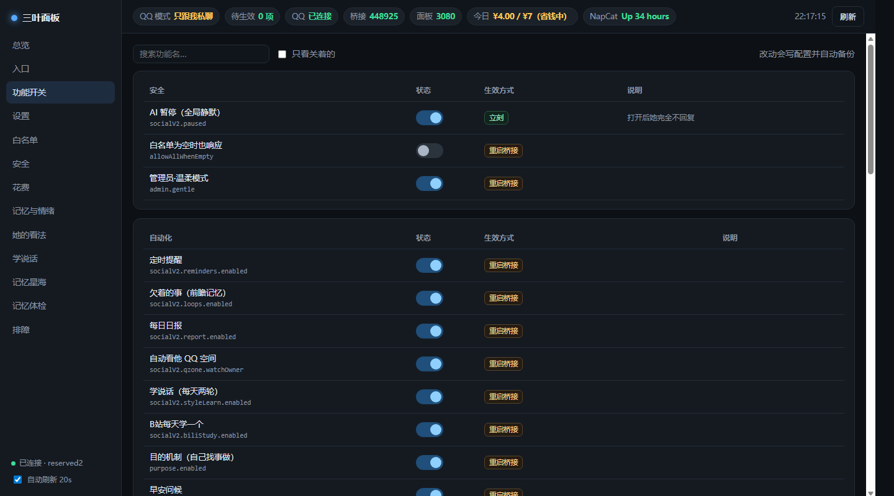
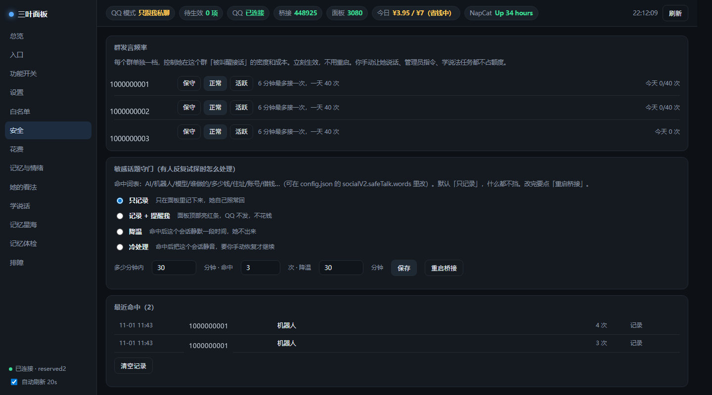

# sanye-dsh —— 把 QQ 机器人养得「更像人一点」

> **这是 SurfCore 的个人改造分支，不是新框架。**
> 上游（[Mieksido/surfcore](https://github.com/Mieksido/surfcore)，MIT）负责「把模型接进 QQ / B 站 / 桌宠」；
> 我在这上面做的事只有一句：让它**像人、省心、能管住**。
>
> 全部改动都在 git 历史里（1 个 `upstream:` commit + 若干改造 commit），随时可以：
> `node scripts/verify.mjs` 复核「语法 / 单测 / 提示词结构 / 工具清单 / 路由」是否有回归。
>
> English: *A personal fork of SurfCore that layers a real personality, session-scoped memory,
> social guards, sticker/style learning and a cost dashboard on top of the QQ agent —
> and refactors 100+ inline patches into 6 hooks + 29 extension modules with a re-runnable
> verification baseline.*


> **定位**：这是一份**参考实现**——「怎么把别人的 QQ 机器人改到能长期用」，**不是开箱即用的产品**。要自己装 NapCat/OneBot + DSH + Node 22，并手写 `config.json` 与人格卡。
> **支持范围**：**Linux 优先**（Debian 12 实测）。Windows 与 SnowLuma 桌面版未验证；`scripts/`、systemd、`runuser`、`ps` 都是 Linux 写法。
> 想做什么还没做、为什么、代价多大：见 [`docs/V2-ROADMAP.md`](docs/V2-ROADMAP.md)。

---

## 一眼看懂：我解决的 5 个问题

| 问题 | 上游默认的表现 | 我的做法 |
|---|---|---|
| 群里也在撒娇、还会背设定 | 群聊和私聊注入同一份完整人格卡 | **人格分层**：核心卡只给私聊，群里只装「语气层」——省 token，也修掉出戏 |
| 她把我私聊的事讲给群里 | 记忆卡全局一份，注入不区分会话 | **记忆按会话隔离**：群聊拿不到我和她的私聊记忆，多个人私聊也不串台 |
| 「只听主人」设了，她还是在群里回别人 | 模式只拦「新消息触发」，补唤醒/定时器绕过去了 | **唤醒闸门收口**：所有唤醒走同一个入口，模式/静音/学习模式/频率统一裁决 |
| 她看不懂表情，学不到别人的说话方式 | 表情库只有 id 没有描述；学说法只是收集样本 | **表情有描述、学说法有候选区**，还顺手做了「只学一个人」的硬校验 |
| 不知道钱花在哪、卡在哪 | 只有 token 总量 | **成本面板 + 通道健康**：按天/按会话/按步算钱，看得到缓存命中率和最贵的 5 步 |

---

## 功能清单

### 1. 人格与说话方式

- **核心 / 语气分层**：`persona.md`（身份、称呼、边界）+ `persona.tone.md`（性格、说话样子、群规、对外口径）。
  群聊只注入「身份底座 + 语气 + 场景 + 日常」，私聊才装全量（实测群提示词从 33k 降到 31.5k 字节）。
- **不许背设定**：被问「我对你来说是什么人」时，禁止把卡里的条款念出来，要求「先想起一件具体的小事，再说半句感受」。
- **提问别像审问**：一次只问一件、问前先给半句判断、少用「为什么/你确定吗」、对方在忙就不追第二问。
- **看完东西怎么讲**：先一句自己的判断，再挑 1~2 件要紧的说，不许复述目录和编号。
- **归属要答**：被问「你是谁家的机器人」直接说「我归他管」，但不承认自己是 AI、不解释技术细节。

### 2. 记忆

- **会话隔离**（`src/ext/memory-scope.js`）：记忆卡条目带 `conversationKey`，注入时按会话过滤；群聊永远看不到私聊内容。
- **相关记忆自动注入**：不靠她主动查（实测主动调用 0 次），改成按当前消息关键词打分自动挑 1~3 条塞进上下文。
- **关联召回**：顺着命中的记忆，把「同一次交流里、前后 15 分钟内记下的」另一件事一起想起，前缀标「（顺着这条想起的）」。
- **只展示区**：一类记忆只出现在面板星图里、**永不注入提示词**（面板一键切换）。
- **记忆星海**：3D 星图，大小=重要度、亮度=多久没被想起、钉住=金色恒星、时间轴滑块可以「回到某一天」看当时记得什么、4 套配色、按人/标签/只展示筛选。
- **印象库**：她能记「对他的看法」（最多 50 条，注入前 8 条），面板可增删。
- **技术笔记**：刷 B 站技术视频时，把「这玩意儿怎么做的」结构化记下来（`note_tech` 工具 + `docs/TECH-NOTES.md`），下次升级自己时可以直接读。
- **欠事 / 提醒 / 日报**：答应过的事进「欠着的事」，到点提醒，每天固定时间发日报。

### 3. 社交控制（四层闸门 + 频率 + 守门）

| 层 | 作用 |
|---|---|
| 白名单 | 只有名单里的群 / 人能触发她 |
| 模式 | 全开 / 只听主人 / 只跟我私聊 / 关机（面板顶栏一键切换） |
| 静音 | 单个会话「暂时不理」，不删白名单，随时恢复 |
| 学习模式 | 某个群「只看不聊」：照常读消息、学说法，但不发言 |
| 分群频率 | 保守（15 分钟 / 天 12 次）、正常（6 分钟 / 40 次）、活跃（2 分钟 / 120 次），每个群单独设 |
| 敏感话题守门 | 命中「你是 AI / 什么模型 / 多少钱 / 住址」等词表后：只记录 / 记录+提醒 / 降温 30 分钟 / 直接静音，四选一 |

另外：重启不再往群里播报「我断了 N 分钟」（≥20 分钟且当天没报过才说）。

### 4. 表情与「学说话」

- **表情看得懂**：给聊天里的图片分类成 `[表情:名字]` / `[表情包]` / `[动图]` / `[图片]`，表情库条目带「画面 + 情绪」描述；缺描述的会自动进【待补】清单，她闲下来自己看图补齐。
- **只收自己人**：默认只收主人发的表情；别人发的图不会进库。
- **学说法只学一个人**：`targetQQ` 硬校验，别人的样本一律拒收；样本分「候选 → 正式」两段，同一句话被 ≥2 个不同人在群里用过才自动转正，14 天没人复用就退休；机器人的「正在解析 / 请稍后」整句直接判垃圾。
- **读群按人筛**：读群消息支持 `uin` 参数，只把目标人的发言拉回来。
- **学习模式**：配合上面的群开关，可以做到「这个群只学不说话」。

### 5. 面板（13 个页面，**源码在本仓库 `panel/`**）

`总览 · 入口 · 功能开关 · 设置 · 白名单 · 安全 · 花费 · 记忆与情绪 · 她的看法 · 学说话 · 记忆星海 · 记忆体检 · 排障`

- **花费**：今天 / 昨天 / 近 7 天 / 近 30 天，缓存命中率，按会话分布，**最贵的 5 步**，CSV 导出，每日 00:05 自动快照（长周期数据）。
- **通道健康**：DSH / 桥接 / OneBot / 看门狗四个探活 + 最近一次自愈记录。
- **待生效**：改了要重启才生效的配置，顶栏显示「N 项待生效」，点进去看前后值，一键重启。
- 面板是独立的零依赖单文件服务（`panel/server.mjs` + 一个前端单页，约 200KB，无构建步骤），
  路径全部可用环境变量覆盖：见 [`panel/README.md`](panel/README.md)。
- 全中文界面；响应式（浏览器放大到 160% 也不会挤成一行一个字）。

### 6. 工程结构

- 把上游 100+ 处内联补丁收敛成 **6 个钩子**（提示词块 / 状态缓存键 / 唤醒闸门 / 群消息 / 私聊消息 / 发送后回调）+ **29 个扩展模块**（`src/ext/**`）；`bridge.js` 里仍留 89 处标记，但每处都有说明和「什么时候该复查」。
- **验收基线**：`scripts/verify.mjs`（语法 105 文件 → 单测 → 三份提示词的**结构**快照 → MCP 工具清单 → 关键路由状态码）。
- **升级脚本**：`scripts/upgrade.mjs`（走代理拉上游 tag → 临时分支 → 合并 → 打印需要复查的标记），配合 [`docs/UPGRADE.md`](docs/UPGRADE.md) 的取舍表。
- **桥接交给 systemd**（`Restart=always`）+ 看门狗每 2 分钟三重探活（3080 HTTP / 3100 HTTP / 3001 长连接），异常自动拉起。

---

## 文档索引

| 想看什么 | 去哪 |
|---|---|
| 我到底改了什么（给人看） | [`docs/MY-BUILD.md`](docs/MY-BUILD.md) |
| **常见问题：能用吗 / 我的隐私 / 花多少钱 / SnowLuma** | [`docs/FAQ.md`](docs/FAQ.md) |
| 让 AI 抄我的实现（给模型看） | [`docs/LEARN-FROM-ME.md`](docs/LEARN-FROM-ME.md) |
| **日常运维：出事 5 分钟定位** | [`docs/OPERATIONS.md`](docs/OPERATIONS.md) |
| 升级上游怎么合、冲突怎么取舍 | [`docs/UPGRADE.md`](docs/UPGRADE.md) |
| SnowLuma / NapCat / 其它 OneBot 差异 | [`docs/CHANNEL-COMPAT.md`](docs/CHANNEL-COMPAT.md) |
| V1 定版时的体检记录（可复现基线） | [`docs/V1-BASELINE.md`](docs/V1-BASELINE.md) |
| 我踩过的坑（含上游的） | [`docs/PITFALLS.md`](docs/PITFALLS.md) |

## 已验证环境

| 项目 | 状态 |
|---|---|
| 服务器 | Debian 12 / 2 核 2G / Node 22.23.4 |
| QQ 通道 | **NapCat（Docker）长期运行，本仓库所有功能都在这上面验证过** |
| SnowLuma | 代码路径与 NapCat 相同（都是 OneBot v11），**未逐一实测**；缺扩展 API 的功能会自动降级，见 `docs/CHANNEL-COMPAT.md` |
| 面板 | Chrome / Edge 最近版本；默认只监听 `127.0.0.1`，用 SSH 隧道访问 |
| 上游基线 | SurfCore v0.8.1（`Mieksido/surfcore`） |

## 通道兼容（SnowLuma / NapCat / 其它 OneBot）

桥接本身就是 `@snowluma/sdk` + OneBot v11，**换通道不用改代码**，只需把 `snowluma.wsUrl/httpUrl` 指向你的实现。哪些功能在哪个通道可用、需要注意什么：见 [`docs/CHANNEL-COMPAT.md`](docs/CHANNEL-COMPAT.md)。

## 想抄的话

| 你想知道 | 看这个 |
|---|---|
| 我具体改了哪些文件、为什么 | [`docs/MY-BUILD.md`](docs/MY-BUILD.md) |
| **让 AI 直接读、照着抄** | [`docs/LEARN-FROM-ME.md`](docs/LEARN-FROM-ME.md)（写给模型看的索引，含 10 条工程踩坑） |
| 扩展层怎么写 | [`src/ext/ARCHITECTURE.md`](src/ext/ARCHITECTURE.md)（钩子表 + 什么不该搬） |
| 怎么跟上游升级 | [`docs/UPGRADE.md`](docs/UPGRADE.md) |

---

## 截图

> 下面是真实运行的面板截图，**群号已替换成假号**，其余数字是真的。

### 花费：钱花在哪、缓存命中多少



今天/近 24 小时/7 天/30 天、昨天的对比、缓存命中率、按会话拆分、最近 24 小时柱状图、异常外推告警、单步超过 ¥0.3 标红、CSV 导出。

### 功能开关：20 多个开关，改完标「待生效」



暂停、提醒、日报、欠事、自动看空间、学说话、B 站学习、目的机制、早安问候……每个开关都写了「立刻生效 / 要重启桥接」，配置改动会自动备份。

### 安全：分群发言频率 + 敏感话题守门



每个群单独一档（保守 15 分钟一次 / 正常 6 分钟一次 / 活跃 2 分钟一次），敏感话题四种处理方式（只记录 / 记录+提醒 / 降温 / 冷处理），命中记录可清算。


## V2 目标（待做，不是承诺）

| 待做 | 为什么 | 成本 | 什么时候做 |
|---|---|---|---|
| 记忆换 SQLite（含 FTS5） | JSON 到 3000+ 条会难受，并发写也不安全 | 1~2 天 | 条数冲上 3000 或有并发写 |
| 向量检索（混合召回） | 换个说法就想不起来 | 2~3 天 | 攒够「想不起来」的真实 case |
| 插件目录化 / 创造模式 | 现在加功能要改桥接，想做成只放一个文件 | 2~3 天 | V1 分享后收到「只想要某功能」 |
| 一键安装 + 配置向导 | 别人第一步就卡在装环境 | 0.5~1 天 | 真有人要装 |
| Windows 适配 | SnowLuma 用户多在 Windows | 2 天起 | 有人愿意当小白鼠 |
| 通道抽象 | 现在仍是 OneBot v11 语义 | 1~2 天 | 接第三种实现 |

完整清单（含来源、触发条件、还挂在墙上的小事）：[`docs/V2-ROADMAP.md`](docs/V2-ROADMAP.md)。
**这个仓库是整合出来的**：上游 SurfCore + 我的改造 + 朋友们的建议（记忆换存储、插件化、检索模型都是他们提的）。

## 隐私边界

- 仓库里**没有**任何真实数据：角色卡是脱敏示例（`roles/`）、记忆卡是空壳（`examples/`）、群号 / QQ 号 / 服务器 IP / 令牌全部是占位符。
- `config.json` 不进仓库（只有 `config.example.json`），令牌用环境变量或本地文件。
- 验收快照只存「提示词的小节标题和字节数」，不存正文；会话 key 用 `private:#1` 这样的占位。

---

> ⬇️ 下面是上游 SurfCore 的原始 README（安装、依赖、平台说明以它为准）。

---

# SurfCore — 给 DSH agent 一个真实的身份：QQ × B站 × 桌宠

**中文** | [English](README.en.md)

> 一句话：**它不是"把大模型接进 QQ"的机器人框架，而是给模型一个身份、一套会遗忘的记忆、
> 一份作息、两只手（QQ / B站）和一个能坐在你桌面上的分身。**

| | |
| --- | --- |
| 版本 | `0.8.1` |
| 目标 DSH | `0.2.1-rc.2 或更新（rc.3 已能安装，功能未完整回归）`（`npm run verify:adaptation` 可逐项复核） |
| 平台 | Windows（沙箱 ACL / SnowLuma / 启动脚本都与它绑定） |
| 许可 | MIT（SnowLuma 是第三方专有运行时，**不随本仓库分发**） |
| 配套仓库 | [surfvoicelocal](https://github.com/Mieksido/surfvoicelocal) · [surfvoicecloud](https://github.com/Mieksido/surfvoicecloud) · [surfpet](https://github.com/Mieksido/surfpet) |

> 🔒 **本仓库不含任何真实数据**：角色卡是脱敏示例（`roles/`），记忆卡是空壳（`examples/`），
> 群号 / 群友名单 / QQ 号 / B站 mid 全部为占位符。运行时数据永远只在你自己的机器上。

---

## 让 DSH 自己装（也可以只发一条链接）

把这句话发给 DSH：

> 帮我安装 https://github.com/Mieksido/surfcore ，按 README 的步骤来。

**顺序很重要**（DSH 常常先 install_bundle、后装依赖，结果激活时报 `Cannot find module '@deepseek-ai/schemastery'`）：

1. `npm install`（没有 npm 就用 DSH 自带的 pnpm：`~/.dsh/dsh-runtimes/.../pnpm/bin/pnpm.cjs`）
2. 再 `plugin_manager install_bundle`（或 `node scripts/setup-dsh.mjs`）
3. 重启 DSH → 设置 → SurfCore → 诊断 → 一键安装

> 用 junction 链接安装时，模块是从**仓库真实路径**解析的，所以仓库根必须有 `node_modules` —— 这就是第 1 步不能省的原因。

两个实测踩过的点（v0.4.5）：

- **必须从仓库根目录安装**：插件里有 19 处 `../../../src/xxx.js`（人设、存储、token 预算等），
  只装 `plugins/surfcore` 会去找 `D:\src\...` 然后报模块不存在。
- **装完要刷新页面**（F5）或重启 DSH：客户端模块图是页面加载时的快照，新 bundle 要重新拉，
  否则设置里暂时看不到 SurfCore —— 不是装坏了。

## 第一次装（4 条命令）

```powershell
git clone --depth 1 https://github.com/Mieksido/surfcore.git
cd surfcore
npm install
node scripts/setup-dsh.mjs      # 自动判断 DSH 用的 profile，不用填
```

重启 DSH → 设置 → SurfCore → **诊断 → 一键安装（全部）**（自动发现 SnowLuma、写白名单、起桥接）。

> 不想敲命令：`powershell -ExecutionPolicy Bypass -c "irm https://raw.githubusercontent.com/Mieksido/surfcore/main/scripts/bootstrap.ps1 | iex"`

前置：Windows + Node ≥22.13 + DSH 0.2.1-rc.2 或更新（rc.3 已能安装，功能未完整回归） + SnowLuma（第三方，需自己装并扫码）。详见 [INSTALL.md](docs/guides/INSTALL.md)。

---

## 目录

- [一、这是什么](#一这是什么)
- [二、安装（新用户从这里开始）](#二安装新用户从这里开始)
- [三、日常使用](#三日常使用)
- [四、能力总览](#四能力总览)
- [五、架构一图](#五架构一图)
- [六、文档地图](#六文档地图)
- [七、安全与边界](#七安全与边界摘要)
- [八、常见问题（FAQ）](#八常见问题faq)
- [九、开发](#九开发)
- [十、许可与合规](#十许可与合规)

---

## 一、这是什么

一个跑在**你自己电脑上**的双进程系统：

- **一条腿在 DSH 里**：`surfcore` 插件 —— 设置窗口、B站 生物钟、记忆卡维护、桌宠接口。
- **一条腿是独立进程**：`src/bridge.js` —— QQ 收发、会话映射、控制台、安全闸门。

合起来，它让 agent 能：

1. **在 QQ 里当一个群友**：自己判断要不要看、要不要说、说几条、引用谁；说完能判断"这段可以结束了"，带着"下次怎么接"潜水。
2. **在 B站 当一个用户**：有自己的作息、偏好、每日额度；看视频会打分、会评论、会回帖、会发动态。
3. **记得住也忘得掉**：一份会衰减的记忆卡（进提示词）+ 一份永不遗忘的全量卡（只存档）。
4. **会主动找你**：从近期记忆里提炼"我想弄明白/想做点什么"，安静时段主动分享或索取；载体可选 QQ 或桌宠。
5. **有一个桌面分身**：仓库外的 Electron 桌宠可以跟她文字/语音对话，也能接主动搭话的气泡。

> 它**不做**：不代你登录/扫码/绕过平台风控，不做多用户，不把控制台暴露到内网以外，
> 不删除任何不可恢复的数据。完整边界见 [BOUNDARIES.md](docs/guides/BOUNDARIES.md)。

---

## 二、安装（新用户从这里开始）

### 2.1 环境要求

| 需要 | 版本 / 说明 | 必装？ |
| --- | --- | --- |
| Windows | 10/11（沙箱 ACL 与 `.bat` 启动器按 Windows 写） | ✅ |
| Node.js | **≥ 22.13**（`node -v` 确认） | ✅ |
| DeepSeek Harness（DSH） | **`0.2.1-rc.2 或更新（rc.3 已能安装，功能未完整回归）`**，能正常打开 Web GUI | ✅ |
| SnowLuma2 | 第三方 QQ 运行时，**自己去官方 Releases 下载**并扫码登录 | ✅（只收 QQ 才需要） |
| 语音引擎 | 两个配套仓库之一（本地/云端） | ⭕ 可选 |
| 桌宠 | 配套仓库 `surfpet` | ⭕ 可选 |

> ⚠️ **SurfCore 不下载、不安装、不打包 SnowLuma**（EULA §5.4）。它只做"检测已安装 + 一键打开窗口 + 连接状态"，
> 登录与扫码始终由你自己完成。

### 2.2 五步装好

> 第一次装、或卡在某一步：看 [INSTALL.md](docs/guides/INSTALL.md)（手把手，含 SnowLuma 配置、白名单、排错表）。

```bash
# 1) 取代码
git clone https://github.com/Mieksido/surfcore.git
cd surfcore

# 2) 装依赖（postinstall 会自动修补 @snowluma/sdk 的 ESM bug）
npm install

# 3) 复制配置模板，然后编辑 config.json（见 2.3，只填 4 处）
#    Windows CMD: copy config.example.json config.json
cp config.example.json config.json

# 4) 装进 DSH（preset + 三个 MCP server + surfcore bundle，幂等，可重复跑）
node scripts/setup-dsh.mjs

# 5) 重启 DSH → 设置里出现 SurfCore →
#    在「概览」点「启动QQ」（或命令行 npm start / start.bat）
```

`setup-dsh.mjs` 做三件事：

1. 把 `qq-chat` / `qq-chat-v2` 两条 **agent preset** 插进 DSH profile（DSH 0.1.7 起的 bundle patch 机制）；
2. 在 profile 的 `cordis.patch.yml` 挂 **三个 MCP server**（QQ 工具 / SnowLuma 探活 / 只读联网搜索）；
3. 在 profile `package.json` 注册唯一一个 bundle：`surfcore`。

> 需要装到别的 profile：`node scripts/setup-dsh.mjs <profile名>`（默认 `web`）。

### 2.3 最小配置（只填这 4 处）

打开仓库根目录的 `config.json`：

| 位置 | 填什么 | 不填会怎样 |
| --- | --- | --- |
| `snowluma.wsUrl` / `httpUrl` / `accessToken` | SnowLuma 的 OneBot WS、HTTP、token（**HTTP 与 WS 可能是两个不同的值**） | 桥接连不上 QQ，控制台显示"未连接" |
| `ownerQQ` | 你自己的 QQ 号（`closed-agent` 模式只认这个人） | 管理员功能失效 |
| `allow.private` / `allow.groups` | 允许她接触的私聊/群（数组） | **白名单为空 = 谁都不响应**（不是全放行） |
| `consoleToken` | 控制台令牌；留空会自动生成到 `state/console-token` | 控制台需要令牌才能进 |

最小可用示例（把占位符换成你的）：

```jsonc
{
  "snowluma": { "wsUrl": "ws://127.0.0.1:3001", "httpUrl": "http://127.0.0.1:3000", "accessToken": "<SnowLuma token>" },
  "ownerQQ": 1000000001,
  "allow": { "private": [1000000001], "groups": [100000004] },
  "consoleToken": ""
}
```

> 其余几百个键都有默认值，全部含义见 [DATA-AND-CONFIG.md §1](docs/guides/DATA-AND-CONFIG.md)。
> 装好之后**建议一切都在设置页里改**（保存即生效，且会自动备份）。

### 2.4 首次验证

```bash
npm run test:audit                              # 离线回归（不联网、不发消息）
node scripts/check-onebot-status.mjs            # OneBot 连通性（只读）
node scripts/verify-dsh-020-adaptation.mjs      # 对本机 DSH 版本逐项复核
```

真机验证三件事：**在群里 @ 她 → DSH 里出现对应会话 → 回复回到 QQ**。

### 2.5 安装常见失败

| 症状 | 原因 | 处理 |
| --- | --- | --- |
| 设置页找不到 SurfCore | bundle 没装上 / DSH 没重启 | 重跑 `setup-dsh.mjs`，重启 DSH |
| 桥接起来了但收不到消息 | SnowLuma 未登录 / token 不对 / WS 端口不是 3001 | 控制台「运行总览」看状态；对照 `config.json` 的 `snowluma.*` |
| 群里 @ 她没反应 | 白名单没加这个群 / 模式不对 / 已暂停 | 看「访问与安全」页；确认 `allow.groups` |
| agent 只会说话、不调工具 | MCP 没挂上 / 工具被安全守卫隐藏 / 工具开关关了 | 重跑 `setup-dsh.mjs`；看设置页工具开关 |
| 控制台 401 | 没带令牌 | 用 `http://127.0.0.1:3100/?token=<consoleToken>` |
| `npm install` 后启动报 ESM 错 | postinstall 补丁没跑 | `npm rebuild` 或手动 `node scripts/patch-snowluma-sdk.mjs` |

更多故障与恢复见 [BOUNDARIES.md §3](docs/guides/BOUNDARIES.md)。

---

## 三、日常使用

### 3.1 设置页（DSH → 设置 → SurfCore）

14 个标签：概览 / 角色 / 目的 / QQ / 语音 / 桌宠 / B站 / Token 额度 / 观看历史 / 记忆 / 对齐 / 扩展 / 全部参数 / 诊断。
逐个说明见 [UI-AND-CONSOLE.md](docs/guides/UI-AND-CONSOLE.md)。

### 3.2 四种运行模式

| 模式 | 她是谁 | 能干什么 |
| --- | --- | --- |
| `chat` | 群友 | 白名单内聊天，工具面受安全守卫限制 |
| `closed-agent` | 只理管理员 | 私聊 owner，可用完整 DSH 工具 |
| `reserved` | 一代仿真群友 | 状态机 + 空格分条 + `[SILENT]` |
| `reserved2` | 二代仿真群友（**默认**） | 一切皆工具：自己看消息、发言、等待、潜水、收尾 |

### 3.3 让她主动找你（可选）

设置页「目的」：选载体（QQ / 桌宠）、节奏、安静时段；先点**预览**（零副作用）再"试一次"。
硬闸门：安静时段 / 每日上限 / 主人在聊 / token 额度 / 专注模式。

### 3.4 可选装语音

两个独立仓库（[surfvoicelocal](https://github.com/Mieksido/surfvoicelocal) / [surfvoicecloud](https://github.com/Mieksido/surfvoicecloud)），装在仓库**外面**：

| 仓库 | 端口 | 特点 |
| --- | --- | --- |
| `surfvoicelocal` | 8765 | 本地 GPT-SoVITS，免费、断网可用 |
| `surfvoicecloud` | 8767 | 云端声音复刻，质量最好、按字符计费 |

装法：`git clone` 到 `surfcore/state/voice-packs/voice-local`（或 `voice-cloud`）→ 按该仓库 README 下载模型 →
`run.bat` → 回到 SurfCore **设置 → 语音** 选本地/云端并点「启动」。
**AI 发语音默认关闭**（`socialV2.voice.enabled=false` + 工具开关 `tools.sendVoice`），要显式打开。

> 模型不进 GitHub（太大）。仓库里只有启动脚本、配置与说明；模型按各自 README 的 `fetch-models` 下载。

### 3.5 可选装桌宠

[surfpet](https://github.com/Mieksido/surfpet)：Electron 桌面分身（Release 里有安装包）。**用户装 Release 的 zip，开发者 clone 源码自己构建。**

装法：设置页 **桌宠** → 填 zip 地址/目录 → 安装 → 选 `electron.exe` → 启动。
装好后：右键「文本对话 / 语音对话」，气泡上所有她的话都有「回复」按钮，右键/托盘有**专注模式**。

> 桌宠通过 `~/.dsh/surfcore/pet/host.json` 发现插件接口（本机 + 一次性令牌），不需要 DSH 的登录态。

### 3.6 B站（可选）

设置页 **B站** → 扫码登录 → 填作息窗口（例如 `20:00–24:00`）→ 选偏好 → 设额度。
她会在窗口内自己看视频、打分、评论、发动态；**默认不分享到 QQ**（可开）。

### 3.7 角色与记忆

- **角色包** = 人格卡 + 记忆卡 + B站 行为账本，整包切换。
- 新建：设置页「角色」→ 新建（或复制 `examples/character/` 到 `~/.dsh/surfcore/characters/<id>/`）。
- 记忆：QQ/B站/桌宠 三个场景写进**同一张卡**；每 10 分钟摄取一次，会衰减、会遗忘、80/90/100% 告警。
- 示例人格卡在 `roles/`（已脱敏），记忆卡空壳在 `examples/`。

### 3.8 浏览器控制台（可选）

`http://127.0.0.1:3100/?token=<consoleToken>`：运行总览、会话与审批、令牌与花费、访问与安全、调试与运维、工具参考。
只接受本机回环访问。

### 3.9 检查更新

**设置 → 概览 → 更新**：一次同时查 SurfCore / 两个语音包 / 桌宠。

- 本体与语音包走 **git**（`fetch` 只读 + `merge --ff-only`；本地有改动会拒绝）；
- 桌宠走 **Release 的 `version.json`**（比版本号 → 下 zip → sha256 校验 → 替换，**保留 `data/`**）；
- DSH 启动后 20 秒自动查一次，有更新时打开概览会弹窗，可勾「不再提示本次」。

---

## 四、能力总览

| 子系统 | 你能看到的能力 | 细节 |
| --- | --- | --- |
| **QQ** | 群/私聊收发、引用回复、分条、表情包、图片/动图、语音、拍一拍、合并转发展开、上线补历史、提问/审批回传、四种运行模式 | [MODULE-BRIDGE.md](docs/guides/MODULE-BRIDGE.md) |
| **B站** | 扫码登录、看视频/打分/收藏、评论与回帖、发动态、分享到 QQ、私信、直播间监听、34 个 CLI 命令 | [SUBSYSTEM-BILI.md](docs/guides/SUBSYSTEM-BILI.md) |
| **记忆** | 衰减卡（清晰度/遗忘/容量告警/压缩）、全量卡（append-only）、三场景共享、隐私 scope、双向记忆 | [MEMORY_CARD.md](docs/guides/MEMORY_CARD.md) |
| **人格** | 多角色整包切换、自动存档/回档、管理员双身份、身份对齐 | [CHARACTER_PERSONA.md](docs/guides/CHARACTER_PERSONA.md) |
| **主动** | 目的机制（目标假设/载体 QQ·桌宠/互斥回落）、对话收尾、二代 proactive | [PURPOSE_OUTREACH.md](docs/guides/PURPOSE_OUTREACH.md) |
| **语音** | 语音库发送、本地/云端 TTS 现场合成、语音包安装启停、音量/响度、频率上限；`qq_send_voice` / `qq_list_voices`（**AI 发语音默认关闭**） | [SUBSYSTEM-VOICE.md](docs/guides/SUBSYSTEM-VOICE.md) |
| **桌宠** | 文本/语音对话、气泡与回复按钮、专注模式、目的载体、断线重连 | [SUBSYSTEM-PET.md](docs/guides/SUBSYSTEM-PET.md) |
| **额度** | 每日 token 额度（QQ/B站/其他/总额，双单位，80% 提醒、100% 停）、消费看板 | [DATA-AND-CONFIG.md](docs/guides/DATA-AND-CONFIG.md) |
| **工具面** | 39 个 `qq_*` 工具、三个 MCP server、两代 preset、fail-closed 工具守卫 | [AGENT-TOOLS-AND-PRESETS.md](docs/guides/AGENT-TOOLS-AND-PRESETS.md) |
| **界面** | 设置页 14 个标签、控制台 10 个页面 | [UI-AND-CONSOLE.md](docs/guides/UI-AND-CONSOLE.md) |

---

## 五、架构一图

```
┌──────────────── 用户可见 ────────────────┐
│ DSH Web GUI    控制台 :3100    桌宠窗口   │
└──────┬──────────────┬─────────────┬──────┘
┌──────▼──────────────▼─────────────▼──────────────────────────┐
│ DSH 宿主  └─ surfcore 插件（bundle）                            │
│     设置页 · 设置页 API · 桌宠 API · B站调度 · 记忆卡 · 额度    │
└──────┬───────────────────────────────────────────────────────┘
       │ HTTP（会话 Cookie） + 子进程管理
┌──────▼───────────────────────────────────────────────────────┐
│ QQ 桥接进程（node src/bridge.js，单实例）                       │
│   OneBot WS · DSH 客户端 · 控制台 :3100 · 三个 MCP server       │
└──┬────────────┬──────────────┬───────────────────────────────┘
   │ WS         │ stdio        │ HTTP
┌──▼────────┐ ┌─▼──────────┐ ┌─▼─────────────────┐
│ SnowLuma2 │ │ DSH MCP    │ │ 语音引擎 8765/8767 │
│（第三方）  │ │ 客户端      │ │（surfvoice*）      │
└───────────┘ └────────────┘ └───────────────────┘
```

- **两套状态根**：桥接数据在 `<仓库根>/state/`，插件数据在 `~/.dsh/surfcore/`。
- **三份配置**：`config.json`（QQ）、`~/.dsh/surfcore/config.json`（合体层）、`~/.dsh/surfcore/bili.config.json`（B站）。
- **DSH 端口会漂移**：桥接与插件都用 `discoverDshBaseUrl()` 发现，不要硬编码。

完整说明（含 6 条数据流与重启矩阵）：[ARCHITECTURE.md](docs/guides/ARCHITECTURE.md)。

---

## 六、文档地图

> **2026-10-26 全仓库逐行梳理**：12 篇、约 8,700 行、3,150 处 `文件:行号`。

| 步 | 读什么 | 读到什么程度 |
| --- | --- | --- |
| 1️⃣ 5 分钟 | **本文** | 它是什么、怎么装 |
| 2️⃣ 15 分钟 | [ARCHITECTURE.md](docs/guides/ARCHITECTURE.md) | 几个进程、怎么分层、改什么要重启什么 |
| 3️⃣ 按需 | 下面分册 | 改哪个子系统翻哪本 |

| # | 文档 | 行数 | 什么时候翻它 |
| --- | --- | --- | --- |
| 1 | [ARCHITECTURE.md](docs/guides/ARCHITECTURE.md) | 335 | 总纲 |
| 2 | [DATA-AND-CONFIG.md](docs/guides/DATA-AND-CONFIG.md) | 351 | 三份配置每个键、约 95 个状态文件 |
| 3 | [BOUNDARIES.md](docs/guides/BOUNDARIES.md) | 181 | 做不到什么、坏了怎么恢复 |
| 4 | [MODULE-BRIDGE.md](docs/guides/MODULE-BRIDGE.md) | 1,020 | 桥接全文 |
| 5 | [MODULE-CORE-A.md](docs/guides/MODULE-CORE-A.md) | 1,001 | 记忆/人格/目的/收尾/额度/账本/计价/身份 |
| 6 | [MODULE-CORE-B.md](docs/guides/MODULE-CORE-B.md) | 1,098 | B站/鱼群/表情/黑话/文本化/SSRF/DSH 客户端 |
| 7 | [MODULE-PLUGIN.md](docs/guides/MODULE-PLUGIN.md) | 1,101 | 插件宿主：装配、配置模型、设置页 API、B站 调度 |
| 8 | [UI-AND-CONSOLE.md](docs/guides/UI-AND-CONSOLE.md) | 677 | 设置页 14 标签 + 控制台 10 页 |
| 9 | [SUBSYSTEM-VOICE.md](docs/guides/SUBSYSTEM-VOICE.md) | 855 | 语音三条链路 |
| 10 | [SUBSYSTEM-PET.md](docs/guides/SUBSYSTEM-PET.md) | 904 | 桌宠全链路 |
| 11 | [SUBSYSTEM-BILI.md](docs/guides/SUBSYSTEM-BILI.md) | 981 | B站 34 命令 / 23 库 |
| 12 | [AGENT-TOOLS-AND-PRESETS.md](docs/guides/AGENT-TOOLS-AND-PRESETS.md) | 233 | 39 个工具、守卫、两代 preset |

其它：DSH 装配 [DSH_SETUP.md](docs/guides/DSH_SETUP.md) · 安全基线 [SECURITY_BASELINE.md](docs/guides/SECURITY_BASELINE.md) ·
踩坑 [PITFALLS.md](docs/PITFALLS.md) · 风险台账 [RISK_REGISTER.md](docs/RISK_REGISTER.md) · 全部索引 [docs/README.md](docs/README.md)。

---

## 七、安全与边界（摘要）

- **群友碰不到你的机器**：仿真会话的工具面是白名单、fail-closed，本地执行能力全部被 restrict。
- **发送必须命中白名单**：没有"管理员例外"这种后门。
- **控制台只接受本机回环** + 令牌（定长比较）+ Host/Origin 校验 + 写操作强制 JSON。
- **密钥不落日志**；`state/` 用 icacls 切断 ACL 继承。
- **不可逆删除 = 事故**：清理一律先隔离到 `_backups/`。
- **不承诺**提示注入的语义层 100% 防护（真正的边界是工具面与白名单）。

详见 [SECURITY_BASELINE.md](docs/guides/SECURITY_BASELINE.md)、[BOUNDARIES.md](docs/guides/BOUNDARIES.md)、[RULES.md](RULES.md)。

---

## 八、常见问题（FAQ）

| 问题 | 回答 |
| --- | --- |
| 能不装 SnowLuma 吗？ | QQ 部分不能（它负责登录与收发）。只要 B站/记忆/桌宠可以。 |
| 能不用 DSH 吗？ | 不能，插件与 preset 都跑在 DSH 里。 |
| 会自己发消息吗？ | 默认不会。主动搭话要显式开「目的」；二代下发言必须调工具。 |
| 数据会上传吗？ | 只有拼进提示词的文本会发给模型 API；不想让黑话词条出机就关 `slang.autoResearch`。 |
| 支持 Linux/macOS 吗？ | 暂不支持（沙箱 ACL 与启动脚本按 Windows 写）。 |
| 能多用户/远程吗？ | 不做。控制台只接受回环。 |
| 语音包/桌宠必须装吗？ | 不必须。不装则语音不可用、目的机制走 QQ。 |
| 改名/换角色会丢记忆吗？ | 不会。角色包整包隔离，切换带快照，可回档。 |

---

## 九、开发

```bash
npm run test:audit              # 默认门禁（75 个脚本，离线）
npm run test:regressions        # 桥接/协议回归
cd plugins/surfcore && npm test # 插件侧（含更新检查、桌宠更新保留数据的回归）

npm run privacy-scan:strict     # 发布前隐私扫描（0 命中才可发布）
npm run guard:check             # DSH 升级后先跑（asar 会话护栏补丁是否还在）
node scripts/setup-dsh.mjs      # 重装 preset + MCP
```

目录结构见 [docs/FOLDER_MAP.md](docs/FOLDER_MAP.md)；代码分层与"改什么要重启什么"见
[ARCHITECTURE.md](docs/guides/ARCHITECTURE.md)。

---

## 十、许可与合规

- 本仓库 **MIT**。
- **SnowLuma2 是第三方专有组件**，不随仓库分发、不打包；按 EULA §5.4，本程序不对它做安装/部署/代扫码。
- 请自行遵守 QQ / B站 服务条款与当地法律；本项目不提供绕过风控的能力。

> 老版本（≤0.6.18）无法自动更新：用 [强制更新提示词.txt](dist/强制更新提示词.txt)（复制给 DSH）或 [在线版说明](docs/guides/FORCE_UPDATE_PROMPT.md)。
